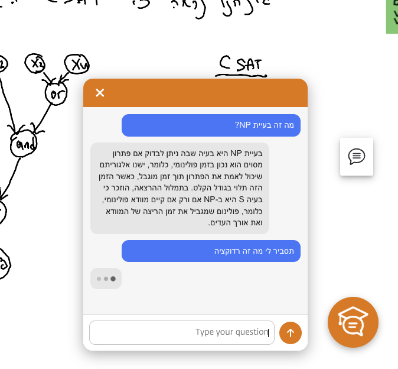

# AI Lecture Assistant

AI Lecture Assistant is a Chrome extension designed to help students study recorded lectures more efficiently.

It provides tools for generating lecture summaries, chatting with an AI assistant based on the lecture transcript, and practicing lecture topics.

The extension works while the user watches a recorded lecture and uses the lecture content to provide learning tools that make reviewing and understanding the material easier.

## Features

* Lecture summary PDF generation
* AI chat based on the lecture transcript
* Lecture topic practice

## Screenshots

### Main Extension Button

The extension adds a floating button on top of the lecture page, allowing the user to access the study tools while watching the lecture.

### Study Tools Menu

The extension provides quick access to the main learning tools: lecture summaries, lecture-based AI chat, and practice questions.

### Lecture-Based AI Chat

The chat interface allows students to ask questions about the lecture while watching, based on the accumulated lecture transcript.

## Tech Stack

* TypeScript
* Chrome `tabCapture`
* Offscreen Documents
* Web Audio API
* Node.js
* Express.js
* WebSocket
* OpenAI API

## Architecture

The project is divided into two main parts:

* **Chrome Extension** - Provides the user interface, manages the lecture flow, and communicates with the backend.
* **Node.js Server** - Handles transcription, AI-based summary generation, lecture Q&A, practice generation, PDF creation, and real-time communication.

The codebase is organized into modular components for content scripts, background logic, offscreen processing, server routes, and backend services.

## Status

This project is a working prototype and personal learning project focused on Chrome Extensions, backend development, audio processing, and AI integration.
