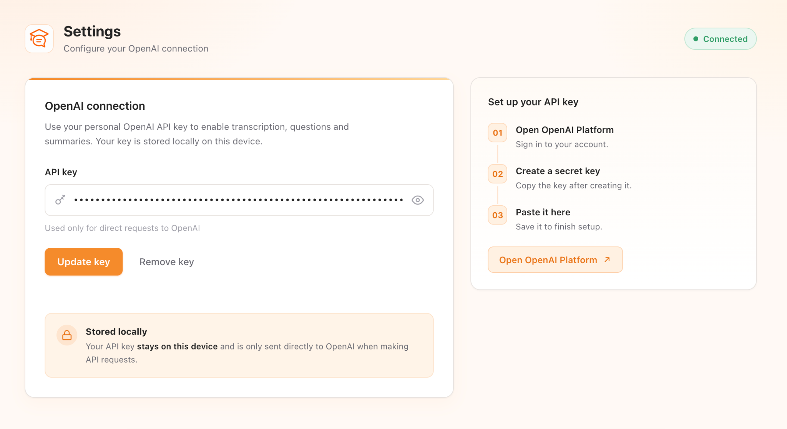
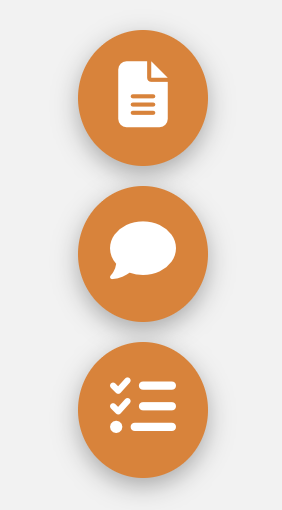
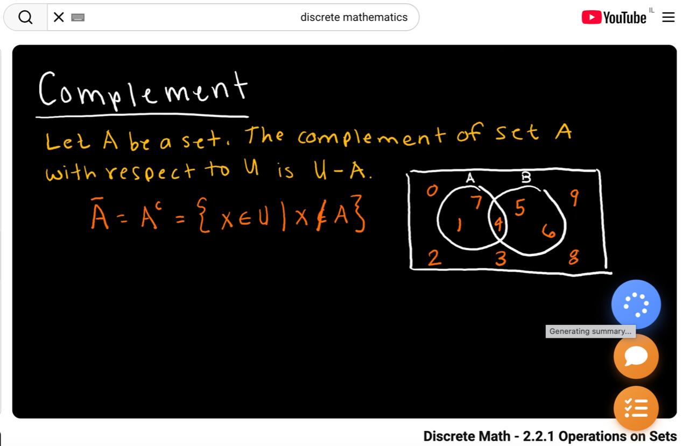
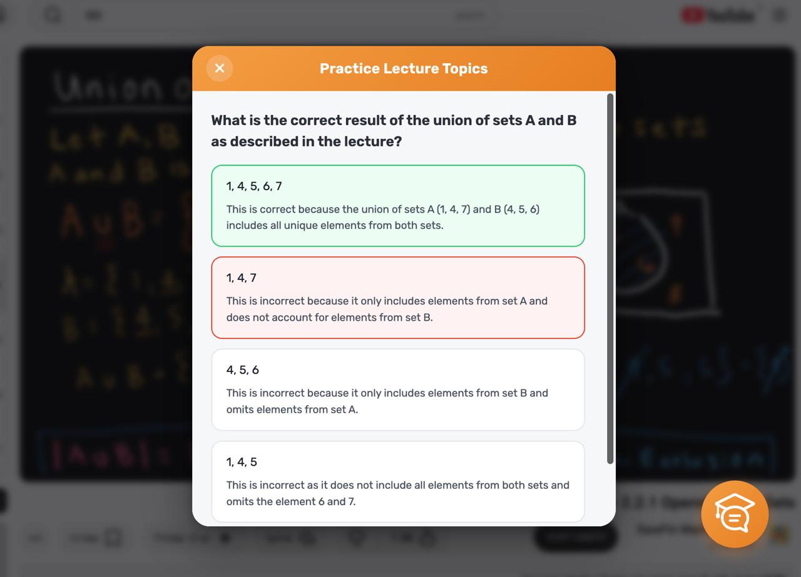

  

<h1 align="center">AI Lecture Assistant</h1>

  A Chrome extension that turns recorded lectures into searchable, interactive study sessions.

  <strong>TypeScript · Chrome Extension Manifest V3 · Real-time transcription · OpenAI-powered study tools</strong>

Overview

AI Lecture Assistant helps students review recorded lectures without leaving the lecture page. After the user activates the extension, it follows video playback, captures tab audio, builds a live lecture transcript, and uses that transcript to provide contextual study tools.

The extension can generate a printable lecture summary, answer questions using the active lecture transcript, and create topic-based multiple-choice practice questions with immediate explanations.

Key Features

Playback-aware capture — starts and pauses recording in response to user-initiated video playback.

Real-time transcription — streams buffered tab audio to a companion transcription server and receives transcript updates over WebSocket.

Lecture-based AI chat — answers questions using the transcript from the active lecture session.

Printable summaries — generates a structured summary that can be printed or saved as a PDF through the browser.

Adaptive practice questions — identifies lecture topics and generates four-option questions with answer feedback and explanations.

Session management — keeps transcript and chat history associated with the active lecture and detects when the user moves to a different lecture.

Personal API key settings — stores the user's OpenAI API key locally in Chrome extension storage for direct AI requests.

Screenshots

API Key Configuration

The settings page provides a guided flow for adding, updating, or removing a personal OpenAI API key.

Main Extension Button

The extension adds a floating control to the lecture page after capture is activated from the Chrome toolbar.

Study Tools Menu

The expandable menu provides quick access to lecture summaries, contextual AI chat, and practice questions.

Summary Generation

The active lecture transcript is converted into a formatted summary that can be printed or saved as a PDF.

Lecture-Based AI Chat

Students can ask questions about the active lecture while watching it. Completed exchanges remain available during the current lecture session.

Practice Questions

The practice interface generates questions from selected lecture topics and provides immediate feedback with an explanation for every answer.

How It Works

flowchart TD
    A["Lecture video"] --> B["Content script"]
    B -->|"Playback events"| C["Service worker"]
    C --> D["Offscreen audio capture"]
    D -->|"WAV chunks"| E["Transcription server"]
    E -->|"WebSocket transcript"| C
    C --> F["OpenAI API"]
    F --> G["Summary, chat, and practice"]

Main Components

Component

Responsibility

Content scripts

Detect video elements, render the in-page interface, and react to playback events.

Background service worker

Coordinate capture state, manage lecture sessions, persist transcript data, and route feature requests.

Offscreen document

Capture tab audio, buffer samples, encode WAV packets, and upload them without interrupting page audio.

Transcription server

Transcribe uploaded audio packets and stream transcript chunks back to the extension over WebSocket.

OpenAI client

Generate summaries, lecture-based answers, topic suggestions, and validated practice questions.

Getting Started

Prerequisites

Google Chrome or another Chromium-based browser with Manifest V3 support

Node.js and npm

An OpenAI API key

The companion transcription server running locally

The current development configuration expects:

Audio uploads at http://localhost:3000/stream

Transcript updates at ws://localhost:3001

Install and Build the Extension

From the extension directory, run:

npm install
npm run build

Load the Extension in Chrome

Open chrome://extensions.

Enable Developer mode.

Select Load unpacked.

Choose the project directory containing manifest.json.

Start the companion transcription server before beginning a lecture session.

Configure API Access

Open the extension's settings page. It opens automatically after the first installation.

Create an API key in the OpenAI Platform.

Paste the key into the settings page and save it.

Configure the transcription server's API key separately in its environment file, then restart the server.

The current prototype uses the locally stored extension key for direct AI study features, while the companion server uses its own environment configuration for transcription.

Usage

Open a page containing a recorded lecture in an HTML video player.

Click the AI Lecture Assistant icon in the Chrome toolbar to activate capture.

Play the video. Recording begins when playback is initiated by the user.

Pause the video to pause audio capture while preserving the active lecture session.

Use the floating controls to generate a summary, ask a question, or practice lecture topics.

Click the toolbar icon again to stop capture and end the active session.

Project Structure

ai-lecture-assistant/
├── src/
│   ├── background/      # Session state, transcript storage, and AI features
│   ├── config/          # Direct OpenAI REST client
│   ├── content/         # In-page controls and lecture interaction
│   ├── offscreen/       # Tab-audio capture, buffering, and WAV encoding
│   ├── options/         # API key settings page
│   ├── background.ts    # Service-worker entry point
│   └── offscreen.ts     # Offscreen-document entry point
├── dist/                # Compiled JavaScript and copied options-page assets
├── images/              # Runtime extension icons and logo
├── assets/              # README screenshots and project media
├── style/               # In-page overlay styles
├── manifest.json        # Chrome extension manifest
├── offscreen.html       # Offscreen document shell
├── package.json
└── tsconfig.json

Tech Stack

Technology

Usage

TypeScript

Extension logic, typed messages, and state management

Chrome Extension Manifest V3

Extension lifecycle, permissions, service worker, and content scripts

Chrome tabCapture

Capture audio from the active lecture tab

Offscreen Documents

Maintain audio processing outside the host page

Web Audio API

Process, buffer, and route captured audio

Fetch API

Upload WAV packets and call OpenAI REST endpoints

WebSocket

Deliver transcript chunks from the server in real time

Node.js and Express

Companion transcription server

OpenAI API

Transcription and transcript-based study features

Development

Command

Description

npm run build

Compile TypeScript and copy the options-page files into dist/options.

npm run watch

Recompile TypeScript when source files change.

After rebuilding, reload the unpacked extension from chrome://extensions so Chrome uses the latest files.

Privacy and Security

The API key entered in the options page is stored in chrome.storage.local; it is not hard-coded in the repository.

API keys and .env files should never be committed to source control.

Captured audio packets are sent to the locally configured transcription endpoint.

Transcript and chat state are stored locally for the active lecture session.

Capture is activated explicitly from the toolbar and begins only when a video is detected and playback starts.

Current Limitations

The project is a development prototype and requires a locally running transcription server.

Development server URLs are currently configured for localhost.

Only one lecture capture session can be active at a time.

Lecture detection depends on an accessible HTML <video> element.

The extension is loaded as an unpacked extension and is not currently distributed through the Chrome Web Store.

Status

AI Lecture Assistant is a working personal project focused on Chrome extension architecture, browser audio capture, asynchronous state management, real-time communication, and AI-assisted learning workflows.
